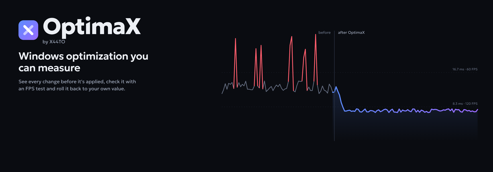
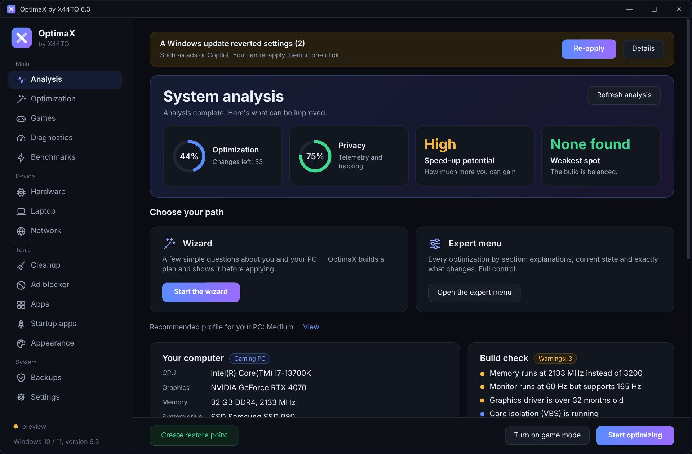
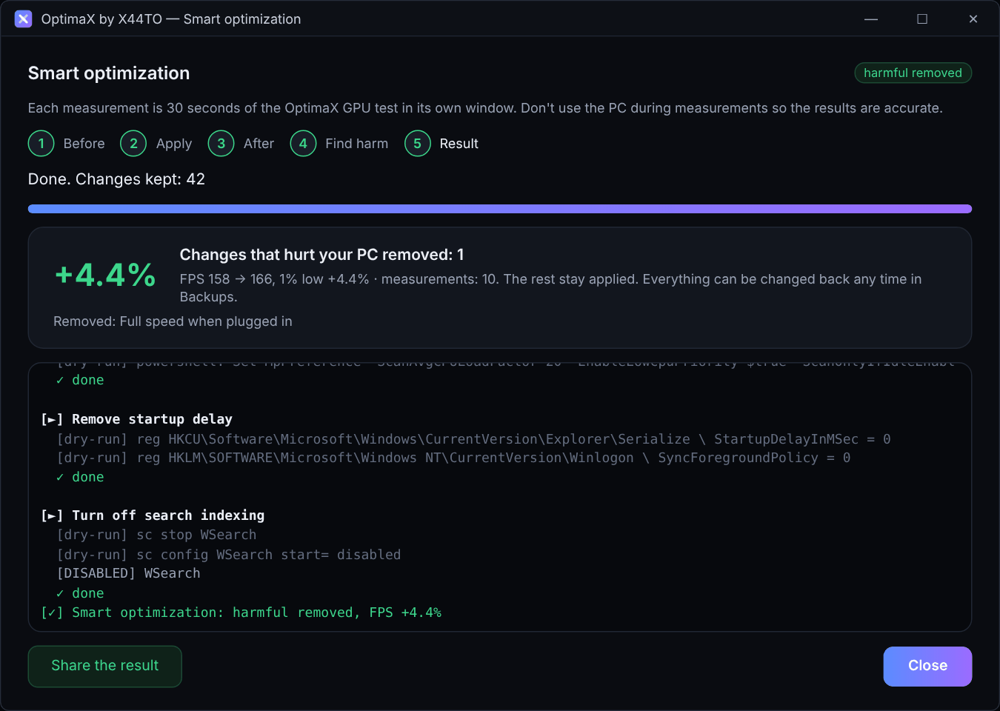
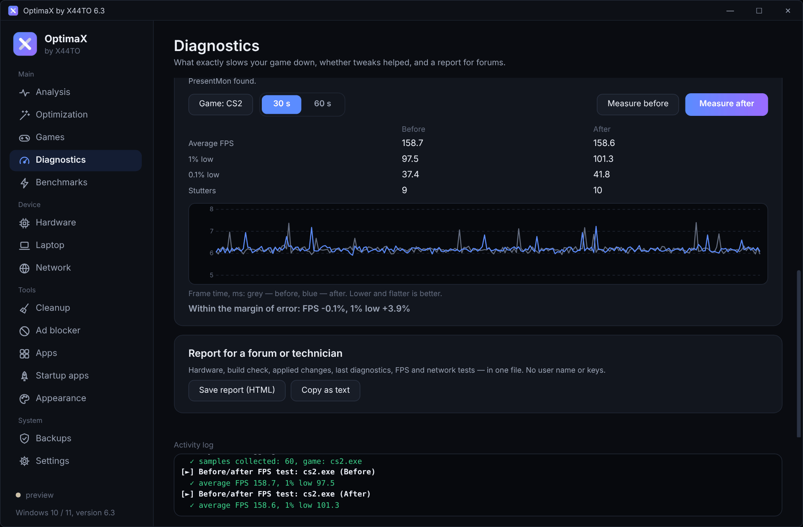
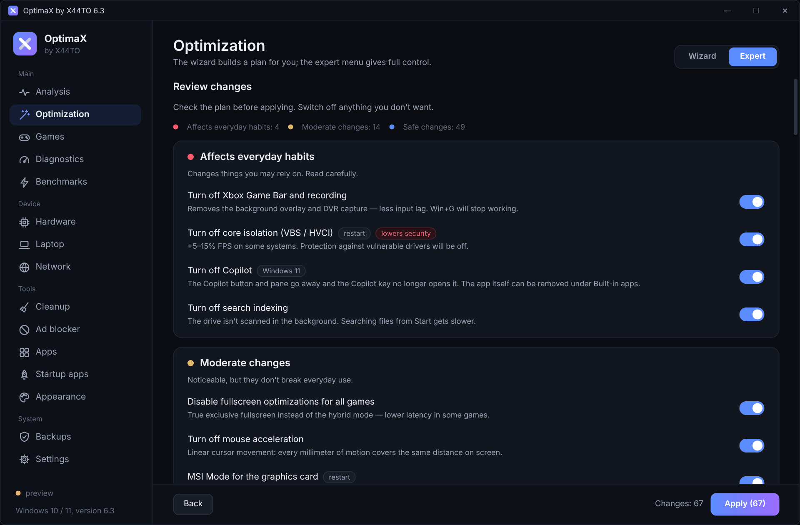
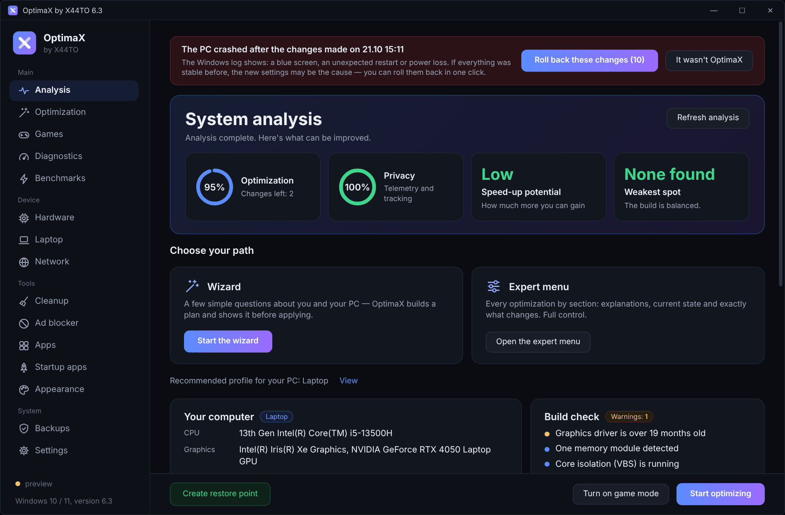
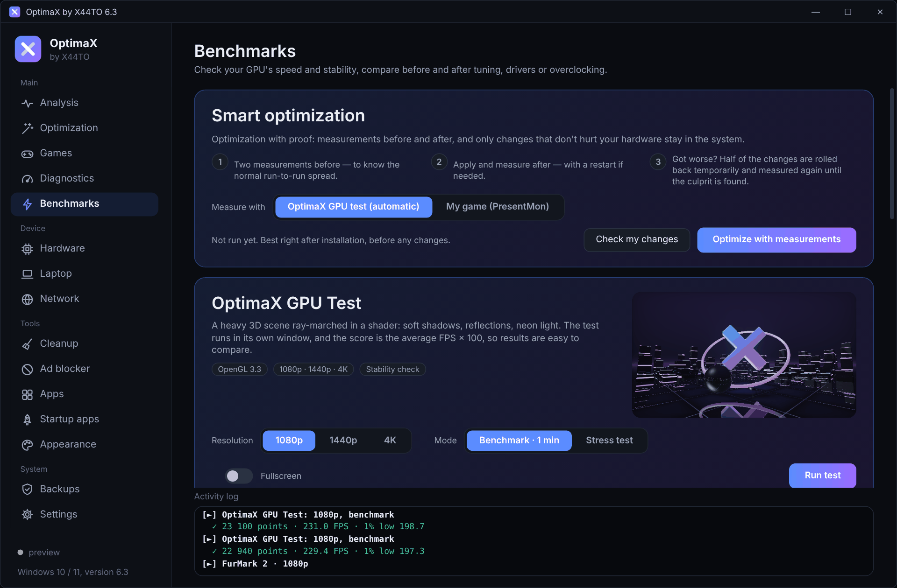
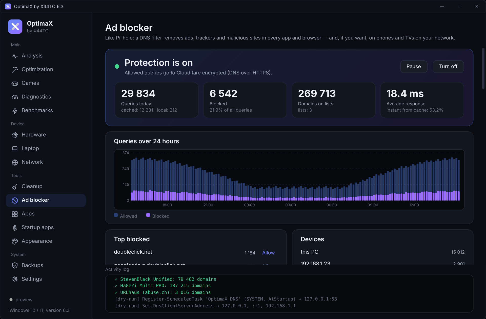
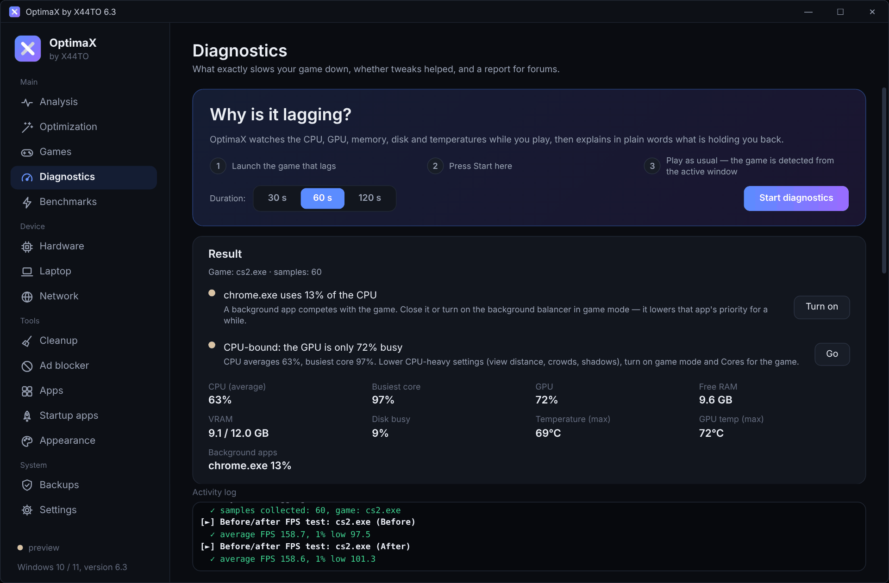
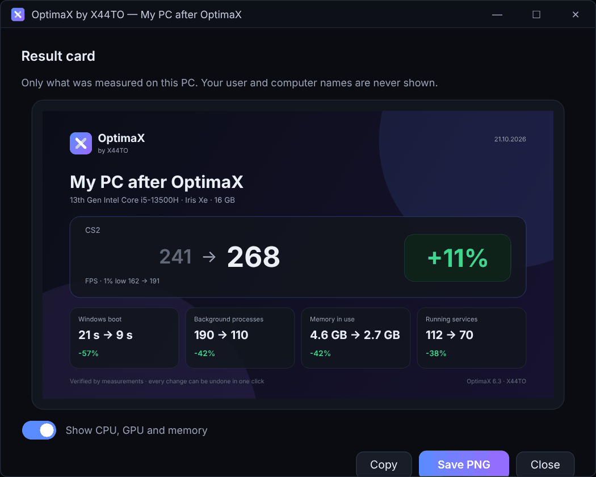

  

  
  
  
  
  

<a href="README.md">Українська</a> &nbsp;|&nbsp; <b>English</b>

**OptimaX** is a free Windows 10 and 11 app that first figures out what hardware your PC has and then suggests an optimization plan. You see every change before it's applied, the result is checked with FPS measurements, and anything can be rolled back to *your* original value. For gaming PCs, laptops, old computers and server Xeons on X99 boards.

  
  &nbsp;
  
  &nbsp;
  

  

## What it does

<table>
<tr>
<td width="50%" valign="top">

### Smart optimization

Measures FPS before and after and keeps only what helped. If things got worse, it finds the culprit by splitting the changes in halves and removes it.

</td>
<td width="50%" valign="top">

### Before/after FPS test

Average FPS, 1% and 0.1% lows, stutters and a frame-time graph through PresentMon. If it got worse, one button rolls back the changes between the measurements.

</td>
</tr>
<tr>
<td valign="top">

### Every change in plain sight

Before applying, the plan is colour-coded: red affects everyday habits, yellow is moderate, blue is safe. For every item you see exactly what will change.

</td>
<td valign="top">

### Emergency rollback

After changes OptimaX watches for blue screens and crash restarts for three days and offers to roll back exactly that batch. `OptimaX-Rescue.cmd` rolls everything back even from Safe Mode.

</td>
</tr>
<tr>
<td valign="top">

### Own GPU test and stress test

A heavy 3D scene with a score and 1% lows. Every 10 seconds the stress test compares a check frame bit for bit, so an unstable overclock or undervolt shows up, not only overheating.

</td>
<td valign="top">

### Ad blocker like Pi-hole

A DNS filter right on your PC: statistics, query log, StevenBlack and HaGeZi lists, encrypted DNS, protection for the whole home network. No Raspberry Pi needed.

</td>
</tr>
<tr>
<td valign="top">

### Why is it lagging?

While you play, it watches the CPU, GPU, memory, disk and temperatures, then explains in plain words: overheating, CPU bottleneck, not enough memory, a background app.

</td>
<td valign="top">

### Result card

An image for Telegram, Discord or a forum: FPS before and after, Windows boot time, processes, memory. Only numbers that were actually measured.

</td>
</tr>
</table>

Also: a wizard and an expert menu with 136 optimizations in 16 sections, 6 profiles (gaming PC, laptop, old PC, Xeon / X99…), game mode, per-game cores on Ryzen X3D and Intel with P/E cores, a settings guard after Windows updates, trial mode, the fastest DNS and ping to game servers, cleanup and a disk analyzer, app updates through winget. Full description in the [guide](docs/en/guide.md).

Screenshots were taken in preview mode on a demo configuration; the numbers illustrate the interface, they don't promise a gain on your PC.

## How it works

1. **Analysis.** OptimaX detects the CPU (P/E cores, AMD X3D, Xeon), graphics cards, memory, drives, monitor and battery and shows the weakest spot of the build.
2. **Plan.** The wizard asks a few simple questions and builds the plan for you; the expert menu gives full control over every item.
3. **Review.** You see every change before it's applied. Anything that harms your particular hardware (such as turning off Game Bar on Ryzen X3D) is blocked with an explanation.
4. **Apply.** A Windows restore point first, then the changes with a console and a Stop button. Optionally, trial mode until the next restart.
5. **Measure.** The FPS test or smart optimization shows whether things really got better.

## Safe by design

- Every change is written to a journal and restored to your original value, not to a “default”.
- `OptimaX-Rescue.cmd` duplicates the journal as Windows commands: it works without the program, from Safe Mode.
- Before every release, GitHub Actions on clean Windows Server 2022 and 2025 applies **every** tweak, checks that it worked, rolls it back and checks that everything returned.
- Preview mode `--dry-run` shows every command without changing anything.
- All the code is open, under the MIT license.

## Installation

1. Download `OptimaX-Setup-<version>.exe` from the [latest release](https://github.com/hatogg/OptimaX-by-X44TO/releases/latest) and run it.
2. Pick a language (Українська, Русский, English); it also becomes the program's language.
3. On the main screen click Start the wizard or open the Expert menu.

The portable `OptimaX-<version>-portable.exe` runs without installation. You need Windows 10 1903+ or Windows 11 (64-bit) and administrator rights; the program asks for them on its own.

> Windows SmartScreen may show “Unknown publisher” because the file isn't signed with a paid certificate. Click More info → Run anyway. You can check that the file wasn't tampered with using `SHA256SUMS.txt` in the release.

## Documentation

| Page | What's inside |
| --- | --- |
| [Guide](docs/en/guide.md) | Everything it can do: smart optimization, emergency rollback, benchmarks, ad blocker, install and uninstall |
| [All optimizations](docs/en/tweaks.md) | 136 changes with explanations, profiles and a rollback mark, generated from the program code |
| [FAQ](docs/en/faq.md) | Administrator rights, antivirus, SmartScreen, what to do if Windows doesn't start |
| [For developers](docs/en/development.md) | Running from source, building the installer, tests, CI, publishing a release |
| [Changelog](CHANGELOG.md) | What's new in every version |

## Contributing

Found a bug or have an idea for a new optimization? [Open an issue](https://github.com/hatogg/OptimaX-by-X44TO/issues/new/choose). Pull requests are welcome: how to add an optimization in two lines and run the tests is in [CONTRIBUTING.md](CONTRIBUTING.md). Report vulnerabilities privately as described in [SECURITY.md](SECURITY.md).

## License

[MIT](LICENSE) © X44TO
