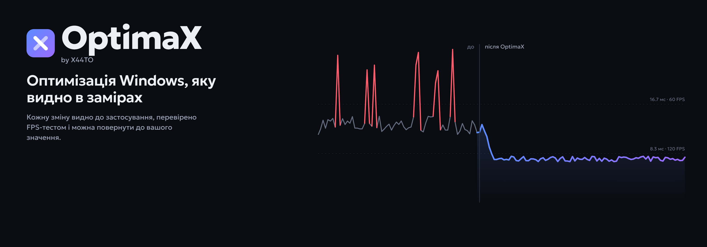
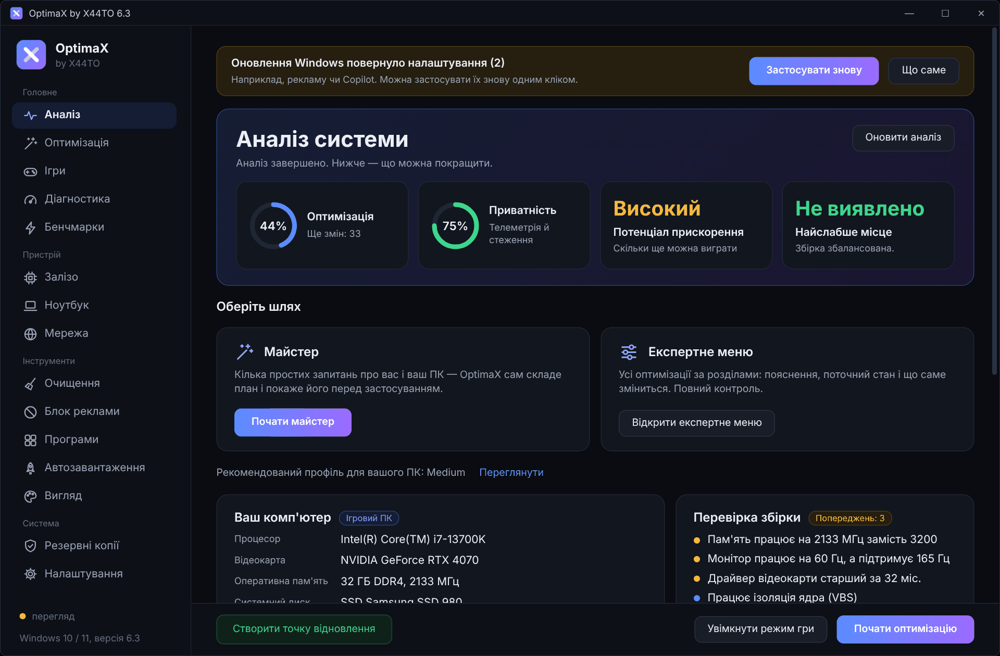
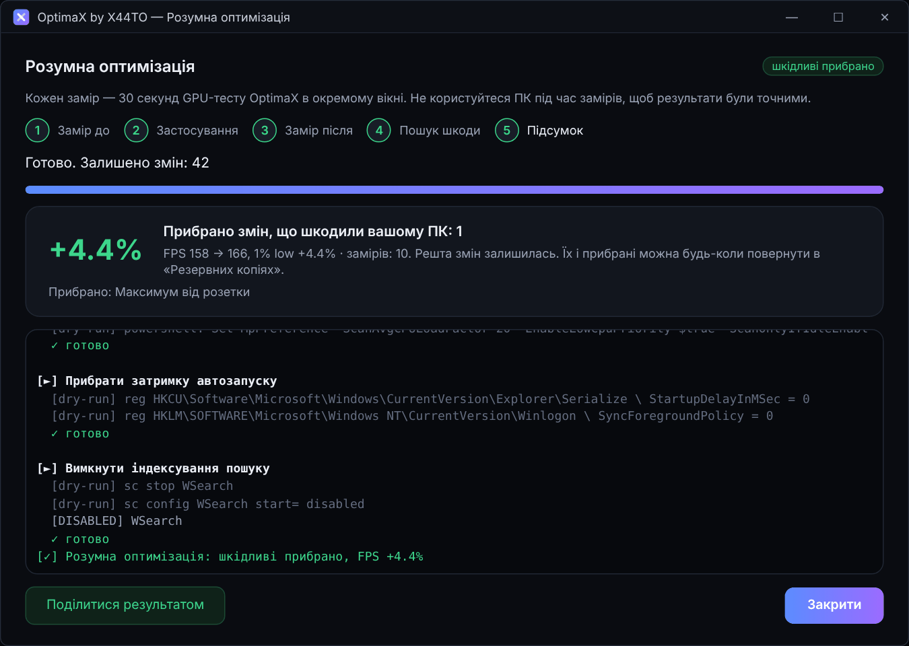
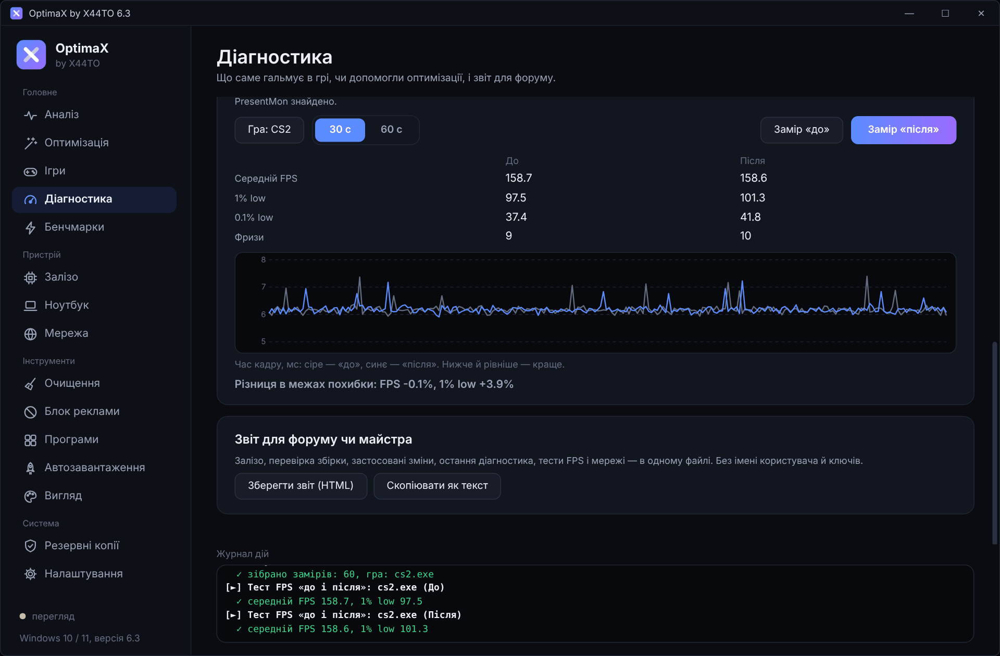
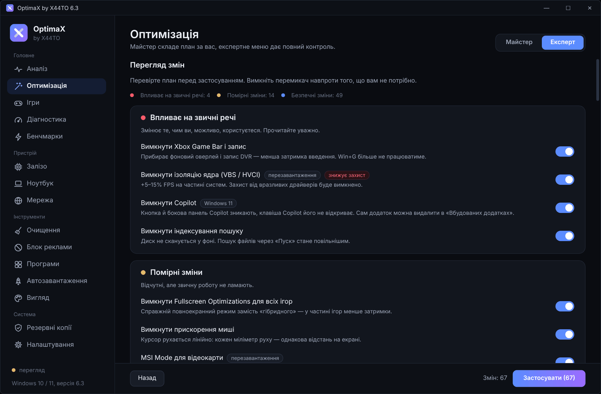
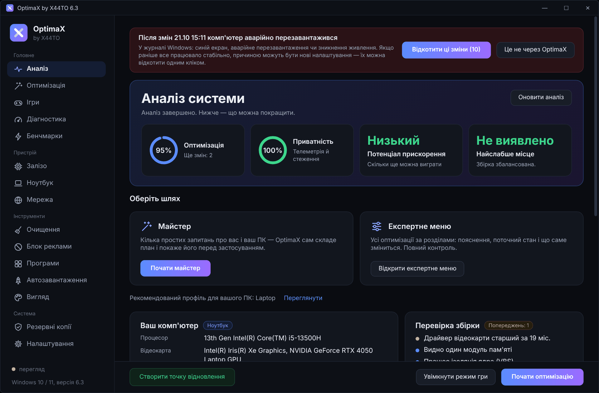
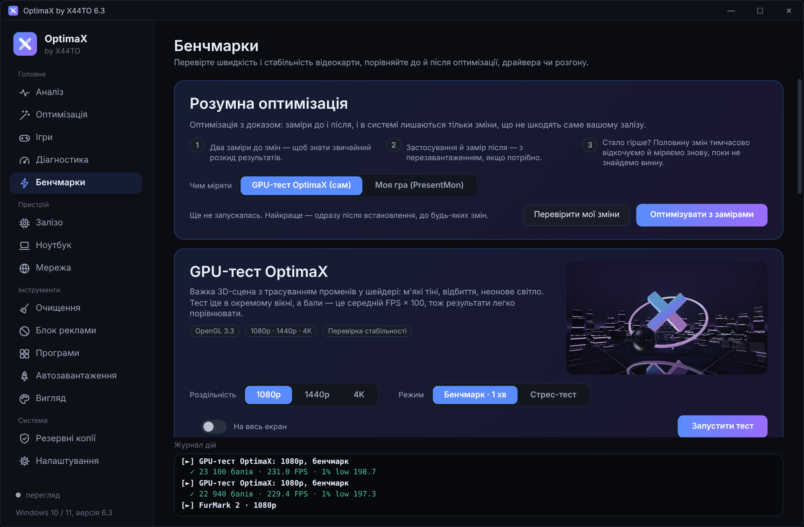
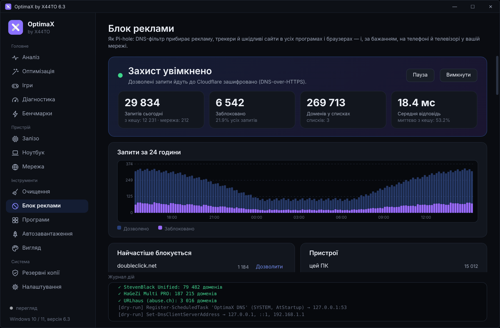
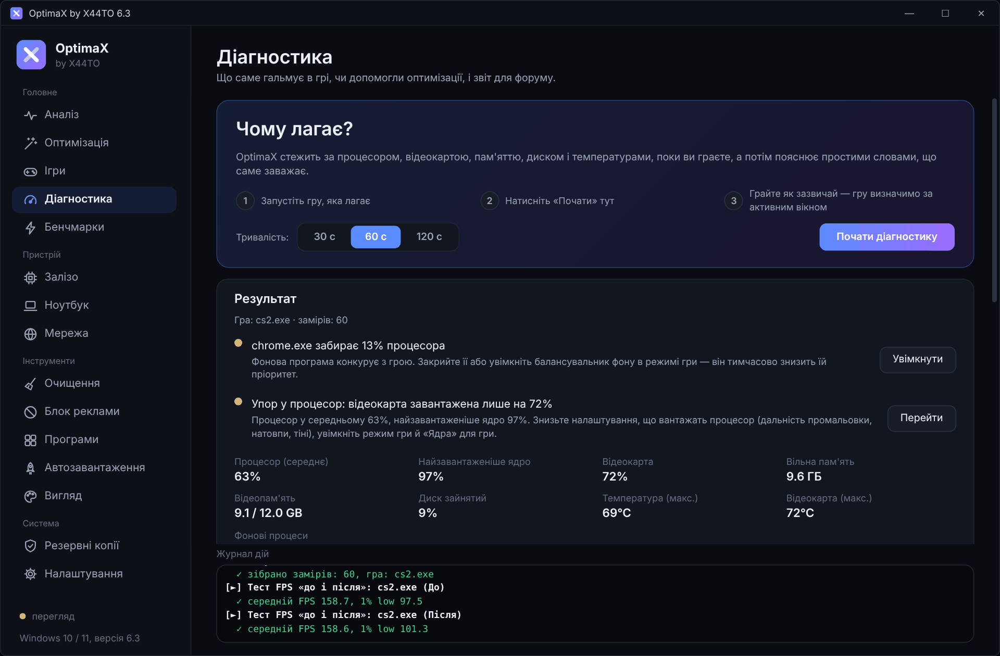
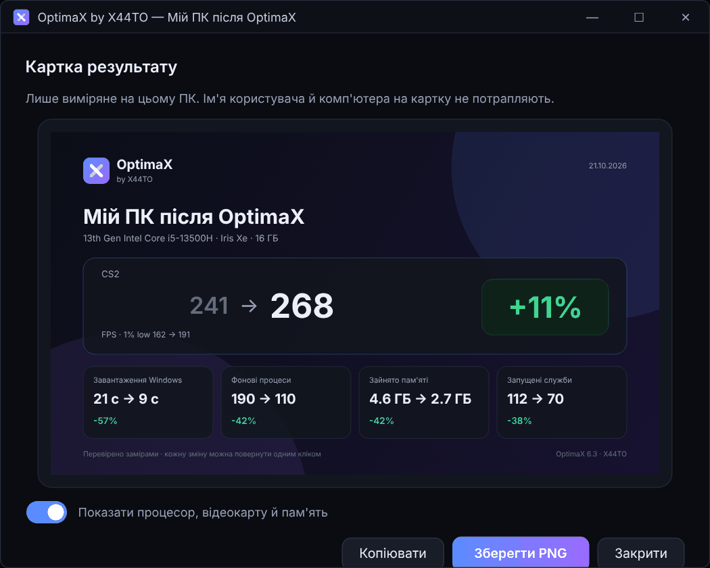

  

  
  
  
  
  

<b>Українська</b> &nbsp;|&nbsp; <a href="README.en.md">English</a>

**OptimaX** — безкоштовна програма для Windows 10 і 11, яка спершу розбирається, що за залізо у вашому ПК, а потім пропонує план оптимізації. Кожну зміну видно до застосування, результат перевіряється замірами FPS, і будь-що повертається до *вашого* початкового значення. Для ігрових ПК, ноутбуків, старих комп'ютерів і серверних Xeon на платах X99.

  
  &nbsp;
  
  &nbsp;
  

  

## Що вміє

<table>
<tr>
<td width="50%" valign="top">

### Розумна оптимізація

Заміряє FPS до і після, залишає лише те, що допомогло. Якщо стало гірше, сама знаходить винну зміну половинним поділом і прибирає її.

</td>
<td width="50%" valign="top">

### Тест FPS «до і після»

3–5 прогонів поспіль і медіана: середній FPS, 1% і 0.1% low, фризи, плавність кадрів через PresentMon. Приріст показано разом із похибкою вимірювання — видно, чи він справжній. Стало гірше — одна кнопка відкочує зміни між замірами.

</td>
</tr>
<tr>
<td valign="top">

### Видно кожну зміну

Перед застосуванням план ділиться за кольором: червоне впливає на звичні речі, жовте — помірні зміни, синє — безпечне. Для кожного пункту видно, що саме зміниться.

</td>
<td valign="top">

### Аварійний відкат

Після змін OptimaX три дні стежить за синіми екранами й аварійними перезавантаженнями і пропонує відкотити саме цей пакет. А `OptimaX-Rescue.cmd` повертає все навіть із безпечного режиму.

</td>
</tr>
<tr>
<td valign="top">

### Власний GPU-тест і стрес-тест

Важка 3D-сцена з балами й 1% low. Стрес-тест раз на 10 секунд звіряє контрольний кадр до біта, тож видно нестабільний розгін чи андервольт, а не лише перегрів.

</td>
<td valign="top">

### Блок реклами як Pi-hole

DNS-фільтр прямо на ПК: статистика, журнал запитів, списки StevenBlack і HaGeZi, шифрований DNS, захист усієї домашньої мережі. Без Raspberry Pi.

</td>
</tr>
<tr>
<td valign="top">

### «Чому лагає?»

Поки ви граєте, стежить за процесором, відеокартою, пам'яттю, диском і температурами, а потім називає головне обмеження (процесор, відеокарта, пам'ять, диск, перегрів) і пояснює простими словами, що з цим робити.

</td>
<td valign="top">

### Картка результату

Картинка для Telegram, Discord чи форуму: FPS до і після, завантаження Windows, процеси, пам'ять. Лише реально заміряні цифри.

</td>
</tr>
</table>

А ще: режими «Безпечний», «Ігровий», «Слабкий ПК» і «Ручний», що складають план саме під ваш ПК, майстер і експертне меню на 136 оптимізацій у 16 розділах, 6 профілів (ігровий ПК, ноутбук, старий ПК, Xeon / X99…), режим гри, ядра для кожної гри на Ryzen X3D і Intel з P/E-ядрами, сторож налаштувань після оновлень Windows, пробний режим, найшвидший DNS і пінг до ігрових серверів, очищення й аналізатор диска, оновлення програм через winget. Повний опис — у [посібнику](docs/uk/guide.md).

Скриншоти зроблено в режимі перегляду на демо-конфігурації; цифри на них ілюструють інтерфейс, а не обіцяють приріст на вашому ПК.

## Як це працює

1. **Аналіз.** OptimaX визначає процесор (P/E-ядра, AMD X3D, Xeon), відеокарти, пам'ять, диски, монітор і батарею, показує найслабше місце збірки.
2. **План.** Режим («Безпечний», «Ігровий», «Слабкий ПК») складає план під ваше залізо й під те, що обмежує FPS; майстер ставить кілька простих запитань, а експертне меню дає повний контроль над кожним пунктом.
3. **Перегляд.** Перед застосуванням видно кожну зміну. Те, що шкодить саме вашому залізу (наприклад, вимкнення Game Bar на Ryzen X3D), заблоковано з поясненням.
4. **Застосування.** Спершу точка відновлення Windows, потім зміни з консоллю й кнопкою «Зупинити». За бажанням — пробний режим до перезавантаження.
5. **Заміри.** Тест FPS або розумна оптимізація показують, чи справді стало краще — з похибкою вимірювання, а зміни, що шкодять саме вашому ПК, прибираються.

## Безпечно за задумом

- Кожна зміна записується в журнал **до** того, як відбудеться, і повертається до вашого початкового значення, а не до «стандартного». Якщо OptimaX аварійно закриється посеред оптимізації, під час наступного запуску вона поверне те, що встигло змінитися.
- Журнал має резервну копію, а перед першою зміною OptimaX запам'ятовує початкові налаштування Windows — навіть якщо журнал загубиться, свої зміни вона знайде й поверне.
- Оновлення запускається лише після перевірки SHA-256 і цифрового підпису, ще раз — безпосередньо перед запуском.
- `OptimaX-Rescue.cmd` дублює журнал командами Windows: працює без програми, з безпечного режиму.
- Перед кожним релізом GitHub Actions на чистих Windows Server 2022 і 2025 застосовує **кожен** твік, перевіряє, що він подіяв, відкочує й перевіряє, що все повернулося.
- Режим перегляду `--dry-run` показує всі команди, нічого не змінюючи.
- Увесь код відкритий, ліцензія MIT.

## Встановлення

1. Завантажте `OptimaX-Setup-<версія>.exe` з [останнього релізу](https://github.com/hatogg/OptimaX-by-X44TO/releases/latest) і запустіть.
2. Виберіть мову (українська, русский, English) — вона ж стане мовою програми.
3. На головному екрані натисніть «Почати майстер» або відкрийте експертне меню.

Портативна версія `OptimaX-<версія>-portable.exe` працює без встановлення. Потрібні Windows 10 1809+ або Windows 11 (64-bit) і права адміністратора — програма попросить їх сама.

> Windows SmartScreen може показати «Невідомий видавець», бо файл не підписаний платним сертифікатом. Натисніть «Докладніше» → «Виконати в будь-якому разі». Перевірити, що файл не підмінено, можна за `SHA256SUMS.txt` у релізі.

## Документація

| Розділ | Що там |
| --- | --- |
| [Посібник](docs/uk/guide.md) | Усі можливості: розумна оптимізація, аварійний відкат, бенчмарки, блок реклами, встановлення й видалення |
| [Усі оптимізації](docs/uk/tweaks.md) | 136 змін із поясненням, профілями й позначкою відкату — створено з коду програми |
| [Часті питання](docs/uk/faq.md) | Права адміністратора, антивірус, SmartScreen, що робити, якщо Windows не завантажується |
| [Для розробників](docs/uk/development.md) | Запуск із коду, збірка інсталятора, тести, CI, публікація релізу |
| [Історія змін](CHANGELOG.md) | Що нового в кожній версії |

## Участь

Знайшли помилку чи маєте ідею нової оптимізації — [відкрийте issue](https://github.com/hatogg/OptimaX-by-X44TO/issues/new/choose). Pull request вітаються: як додати оптимізацію за два рядки й прогнати тести, написано в [CONTRIBUTING.md](CONTRIBUTING.md). Про вразливості — приватно, за [SECURITY.md](SECURITY.md).

## Ліцензія

[MIT](LICENSE) © X44TO
