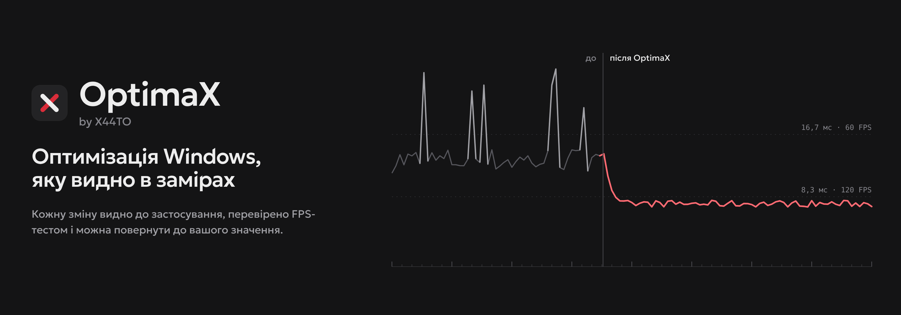
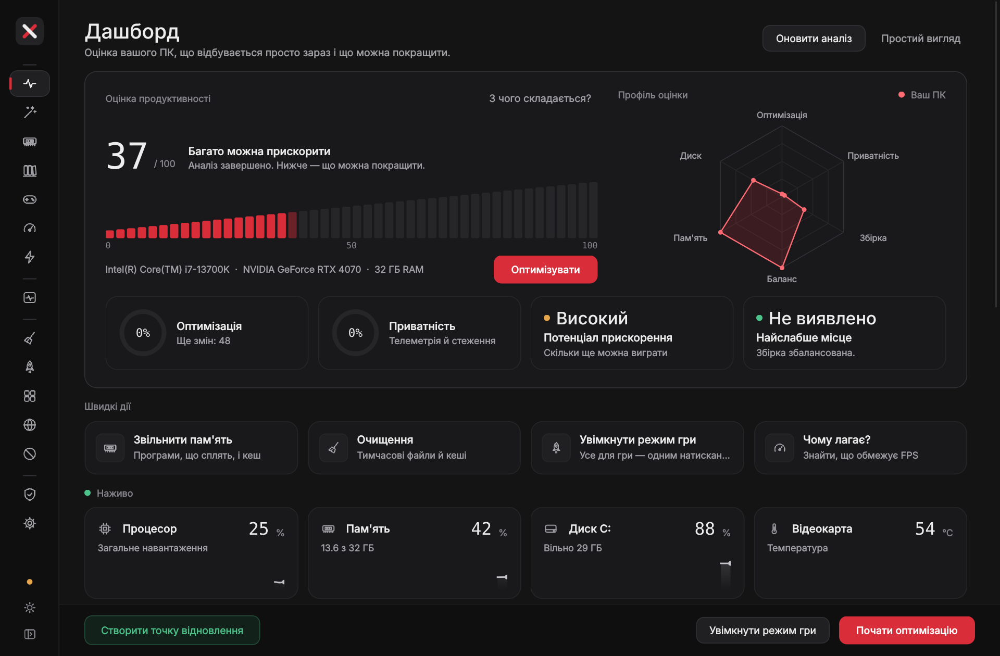
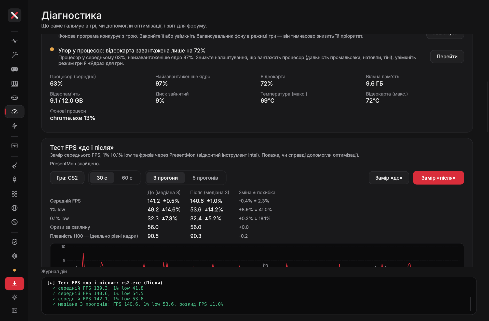
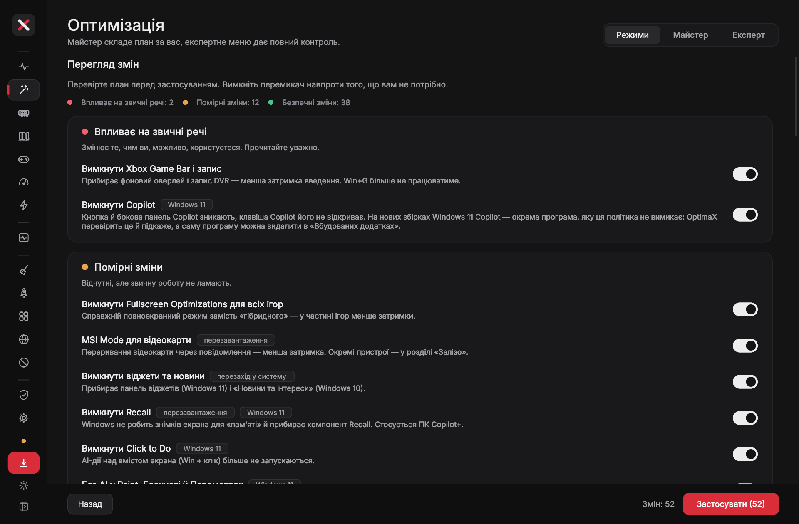
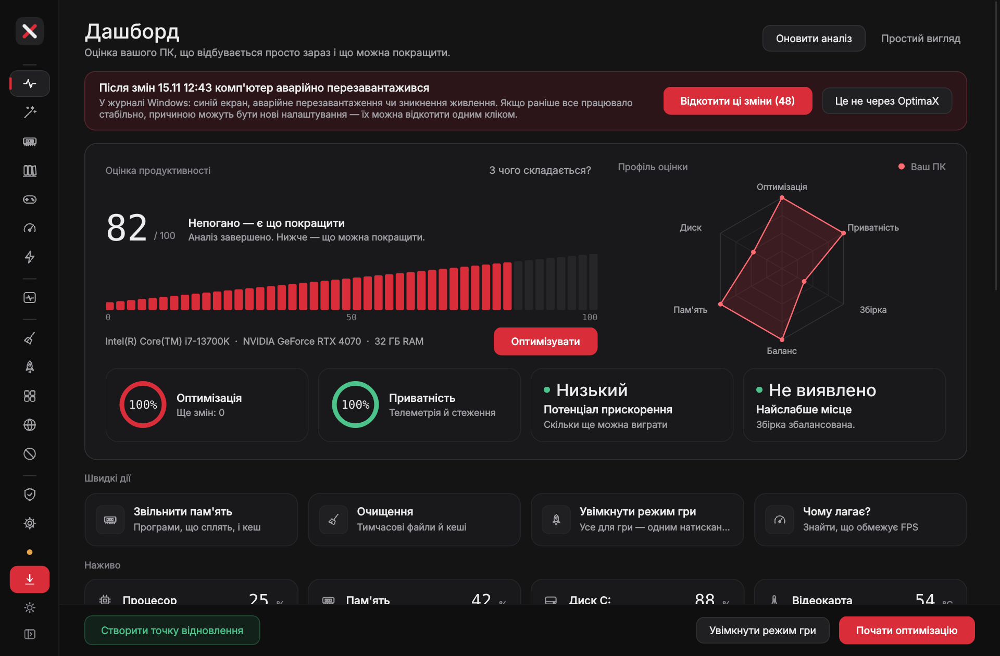
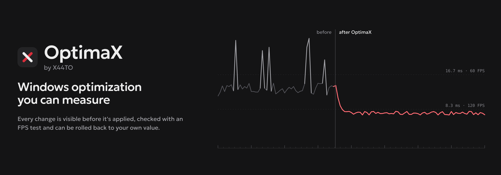

<p align="center">
  
</p>

<p align="center">
  <b>Безкоштовно · відкритий код (MIT) · Windows 10 (1809+) і Windows 11, 64-bit</b>
</p>

<p align="center">
  <a href="https://github.com/hatogg/OptimaX-by-X44TO/releases/download/v7.0.0/OptimaX-Setup-7.0.0.exe"><b>Завантажити інсталятор</b></a> &nbsp;·&nbsp; 28,6 МБ
  &nbsp;&nbsp;&nbsp;|&nbsp;&nbsp;&nbsp;
  <a href="https://github.com/hatogg/OptimaX-by-X44TO/releases/download/v7.0.0/OptimaX-7.0.0-portable.exe"><b>Портативна версія</b></a> &nbsp;·&nbsp; 40,3 МБ, без встановлення
</p>

---

## Що нового

7.0.0 — перший реліз після 6.15. У ньому новий вигляд і все з 6.16 та 6.17, які окремо не виходили. Налаштування, ігри й журнал змін після оновлення залишаються.

### Новий вигляд

Графіт і один червоний акцент X44TO замість синьо-фіолетових градієнтів. Акцент — лише на основній дії, вибраному пункті й ключовому числі; зелений, жовтий і червоний, як і раніше, означають стан. Показники — моноширинним шрифтом з одиницями, як на приладі, на кожному екрані одна основна кнопка, новий логотип. Світла тема теж оновлена.

<table>
  <tr>
    <td width="50%"></td>
    <td width="50%"></td>
  </tr>
  <tr>
    <td align="center">Дашборд: оцінка ПК, найслабше місце, живі показники</td>
    <td align="center">Тест FPS «до і після» з похибкою вимірювання</td>
  </tr>
</table>

### «Здоров'я ПК»

Нова перша картка на сторінці «Діагностика»: 14 перевірок Windows за хвилину, лише читання — диски, сині екрани й раптові вимкнення, пристрої з помилками, Windows Update, антивірус, брандмауер, UAC, SMBv1, точність годинника, звук. Оцінка 0–100 і пояснення простими словами, до кожної картки — команда PowerShell для самоперевірки.

- **«Виправити все безпечне»** — один план із дій, які нічого не вимикають (оновити сигнатури, синхронізувати час, перезапустити звук…), з повторною перевіркою після.
- Решта виправлень — окремою кнопкою з поясненням, що може перестати працювати, через журнал відкату й з точкою відновлення.
- Жодна дія не вимикає антивірус і не додає йому виключень.

### Надійніший відкат і безпека

Незалежний аудит коду знайшов місця, де стороння програма могла б підсунути OptimaX чуже «оновлення» чи команду для аварійного відкату. Усе закрито.

- Зміни й відкати виконуються строго по одній; запис для відкату з'являється до зміни, а «Зупинити» не обриває команду посередині.
- `OptimaX-Rescue.cmd` не позначає відкат виконаним, якщо якийсь крок не вдався, і не перетворює старі значення реєстру на команди.
- Оновлення завантажуються лише з релізів цього репозиторію; winget і cdb запускаються лише з Program Files.
- Скидання Windows Update, файл підкачки, DNS і DoH чесно кажуть «частково», якщо крок не вдався.

### Чесніші оптимізації

- «Точний таймер 0.5 мс» — лише Windows 11: на Windows 10 він діє тільки на саму OptimaX.
- Dynamic Tick і «Заборонити простій процесора» прибрані з готових профілів — лише вручну з перевіркою «до/після».
- System Responsiveness = 10 замість 0: значення менше 10 Windows і так замінює на 20.

<table>
  <tr>
    <td width="50%"></td>
    <td width="50%"></td>
  </tr>
  <tr>
    <td align="center">Кожну зміну видно до застосування</td>
    <td align="center">Після аварійного перезавантаження — відкат останніх змін</td>
  </tr>
</table>

---

## Файли

| Файл | Для чого | Розмір |
| --- | --- | ---: |
| [`OptimaX-Setup-7.0.0.exe`](https://github.com/hatogg/OptimaX-by-X44TO/releases/download/v7.0.0/OptimaX-Setup-7.0.0.exe) | Інсталятор — для більшості | 28,6 МБ |
| [`OptimaX-7.0.0-portable.exe`](https://github.com/hatogg/OptimaX-by-X44TO/releases/download/v7.0.0/OptimaX-7.0.0-portable.exe) | Без встановлення, з флешки | 40,3 МБ |
| [`OptimaX-Rescue.cmd`](https://github.com/hatogg/OptimaX-by-X44TO/releases/download/v7.0.0/OptimaX-Rescue.cmd) | Аварійний відкат усіх змін, працює в безпечному режимі | — |
| `OptimaX-DXVK-2.6.2.zip`, `OptimaX-Mesa-26.2.0.zip` | Рендерери для ігор на майнінгових картах; програма завантажує їх сама | 9,6 / 41,9 МБ |
| `SHA256SUMS.txt` | Контрольні суми всіх файлів | — |

**Перевірити, що файл справжній** (PowerShell):

```powershell
Get-FileHash .\OptimaX-Setup-7.0.0.exe
# 294715912057152D0CD0079E0987F2A64202F55842711FF1AF45F90A686E73D4
```

```text
294715912057152d0cd0079e0987f2a64202f55842711ff1af45f90a686e73d4  OptimaX-Setup-7.0.0.exe
481bf9dda9aff7817a0b6196487193e784fb99b2431cba4013fded5d94f4f1eb  OptimaX-7.0.0-portable.exe
```

**Windows SmartScreen пише «Невідомий видавець»?** Натисніть «Докладніше» → «Виконати в будь-якому разі». Файл не підписаний платним сертифікатом; збирає його GitHub Actions із цього коду, а справжність підтверджує хеш вище.

Повна історія змін — у [CHANGELOG.md](https://github.com/hatogg/OptimaX-by-X44TO/blob/v7.0.0/CHANGELOG.md) · [Посібник](https://github.com/hatogg/OptimaX-by-X44TO/blob/main/docs/uk/guide.md) · [Сайт](https://hatogg.github.io/OptimaX-by-X44TO/) · [Повідомити про помилку](https://github.com/hatogg/OptimaX-by-X44TO/issues/new/choose)

<details>
<summary><b>English</b></summary>

<p align="center">
  
</p>

**Free · open source (MIT) · Windows 10 (1809+) and Windows 11, 64-bit.** Download the [installer](https://github.com/hatogg/OptimaX-by-X44TO/releases/download/v7.0.0/OptimaX-Setup-7.0.0.exe) (28.6 MB) or the [portable version](https://github.com/hatogg/OptimaX-by-X44TO/releases/download/v7.0.0/OptimaX-7.0.0-portable.exe) (40.3 MB).

7.0.0 is the first release after 6.15. It brings a new look plus everything from 6.16 and 6.17, which were never released on their own. Settings, games and the change journal are kept after the update.

**New look.** Graphite and a single X44TO red accent instead of blue-violet gradients. The accent marks only the primary action, the selection and the key figure; green, amber and red still mean state. Readings use a monospaced face with units, like an instrument; every screen has one primary button; new logo; refreshed light theme.

**PC health.** A new first card on the Diagnostics page: 14 read-only Windows checks in about a minute — drives, blue screens and sudden shutdowns, devices with errors, Windows Update, antivirus, firewall, UAC, SMBv1, clock accuracy, audio. A 0–100 score with plain-language explanations and a PowerShell command to check each card yourself. *Fix everything safe* runs one plan of actions that turn nothing off and re-checks afterwards; other fixes are separate, explain what may stop working and go through the rollback journal with a restore point. Nothing disables the antivirus or adds exclusions.

**More reliable rollback and security.** An independent code audit found places where another program could slip OptimaX a fake “update” or an emergency-rollback command; all closed. Changes and rollbacks run strictly one at a time, the undo record exists before the change, and Stop never cuts a command in half. `OptimaX-Rescue.cmd` no longer marks a rollback done when a step failed and no longer turns old registry strings into commands. Updates come only from this repository's releases; winget and cdb run only from Program Files. Windows Update reset, page file, DNS and DoH report partial results honestly.

**More honest optimizations.** The 0.5 ms precise timer is Windows 11 only (on Windows 10 it affects only OptimaX itself). Dynamic Tick and Disable processor idle are no longer in ready-made profiles — manual only, with a before/after check. System Responsiveness = 10 instead of 0 (Windows replaces values below 10 with 20).

**Verify the file:** `Get-FileHash .\OptimaX-Setup-7.0.0.exe` must match the line in `SHA256SUMS.txt`. **SmartScreen says “Unknown publisher”?** Click More info → Run anyway: the file isn't signed with a paid certificate; it is built by GitHub Actions from this code.

Full history in [CHANGELOG.md](https://github.com/hatogg/OptimaX-by-X44TO/blob/v7.0.0/CHANGELOG.md) · [Guide](https://github.com/hatogg/OptimaX-by-X44TO/blob/main/docs/en/guide.md) · [Website](https://hatogg.github.io/OptimaX-by-X44TO/en.html)
</details>
