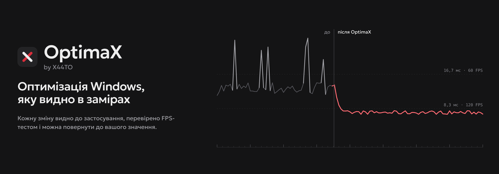
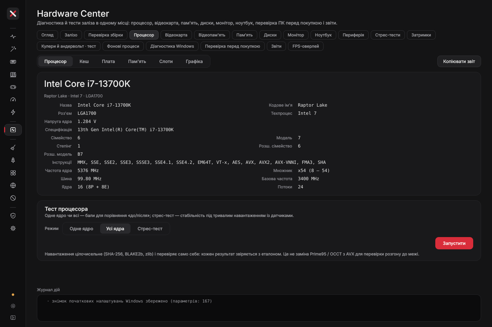
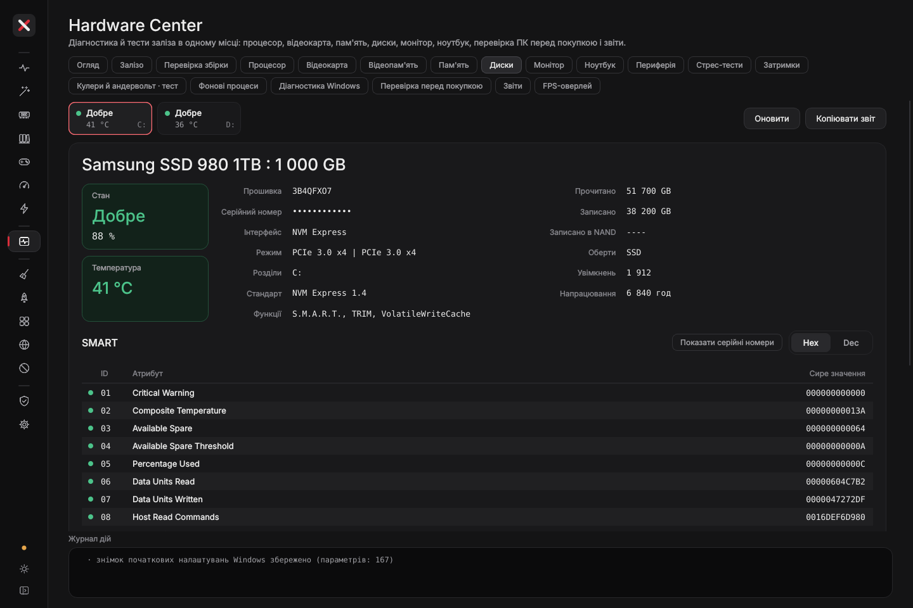
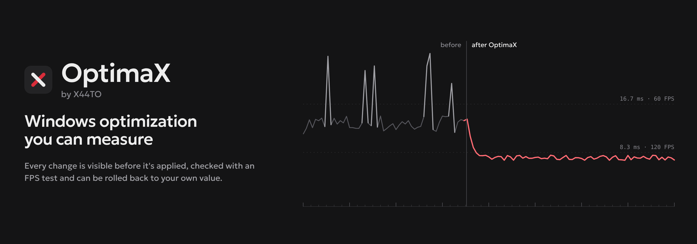

<p align="center">
  
</p>

<p align="center">
  <b>Безкоштовно · відкритий код (MIT) · Windows 10 (1809+) і Windows 11, 64-bit</b>
</p>

<p align="center">
  <a href="https://github.com/hatogg/OptimaX-by-X44TO/releases/download/v7.1.0/OptimaX-Setup-7.1.0.exe"><b>Завантажити інсталятор</b></a> &nbsp;·&nbsp; __SETUP_MB__ МБ
  &nbsp;&nbsp;&nbsp;|&nbsp;&nbsp;&nbsp;
  <a href="https://github.com/hatogg/OptimaX-by-X44TO/releases/download/v7.1.0/OptimaX-7.1.0-portable.exe"><b>Портативна версія</b></a> &nbsp;·&nbsp; __PORTABLE_MB__ МБ, без встановлення
</p>

---

## Що нового

У Hardware Center з'явилися аналоги CPU-Z і CrystalDiskInfo, а також виправлення за вашими відгуками на 7.0.0. Налаштування, ігри й журнал змін після оновлення залишаються.

### «Процесор» — як CPU-Z

Вкладки «Процесор», «Кеш», «Плата», «Пам'ять», «Слоти», «Графіка».

- **Процесор:** назва, кодове ім'я й техпроцес (Intel від Merom до Arrow Lake, AMD від Bulldozer до Zen 5), роз'єм, набір інструкцій, P- і E-ядра, частота наживо.
- **Кеш** L1 / L2 / L3 з розміром і асоціативністю; **плата**, чипсет, BIOS, режим PCIe відеокарти.
- **Пам'ять і слоти:** тип, канали, частота, виробник, партномер, ранг і напруга кожного модуля.
- **З безкоштовним драйвером [PawnIO](https://pawnio.eu)** — ще множник, напруга ядра й справжня шина, а для DDR4 / DDR5 — таймінги JEDEC з SPD, тиждень випуску й наявність XMP / EXPO. OptimaX драйвер не ставить і в регістри процесора нічого не пише; без PawnIO ці поля чесно кажуть «потрібен PawnIO».
- «Копіювати звіт» — текстом, як «Save report» у CPU-Z.

### «Диски» — як CrystalDiskInfo

Стан («Добре / Увага / Погано») із залишком ресурсу, температура, прошивка, режим (SATA/600 чи PCIe 4.0 x4), функції, записано й прочитано в одиницях свого виробника, повна таблиця SMART і журнал NVMe. Серійні номери приховані, доки їх не відкрити. Дані читаються, щойно відкрито розділ, і оновлюються кожні 5 хвилин.

<table>
  <tr>
    <td width="50%"></td>
    <td width="50%"></td>
  </tr>
  <tr>
    <td align="center">«Процесор»: паспорт, як у CPU-Z</td>
    <td align="center">«Диски»: стан і таблиця SMART, як у CrystalDiskInfo</td>
  </tr>
</table>

### Виправлено за вашими відгуками

- **Resizable BAR «вимкнено», хоча він увімкнений** (AMD SAM, а також NVIDIA та Intel Arc) — розмір BAR тепер читається з карти ресурсів Windows.
- **Зношений SSD — «диски в порядку».** OptimaX читає SMART сама: залишок ресурсу й атрибути на порозі відмови (наприклад, Kingston A400). А новий Samsung / Intel / WD більше не виходить «зношеним».
- **Interrupt Moderation і Flow Control, вимкнені вручну, не видно** на частині адаптерів Realtek 2.5G і USB. Віртуальні адаптери VPN за Ethernet більше не вважаються.

---

## Файли

| Файл | Для чого | Розмір |
| --- | --- | ---: |
| [`OptimaX-Setup-7.1.0.exe`](https://github.com/hatogg/OptimaX-by-X44TO/releases/download/v7.1.0/OptimaX-Setup-7.1.0.exe) | Інсталятор — для більшості | __SETUP_MB__ МБ |
| [`OptimaX-7.1.0-portable.exe`](https://github.com/hatogg/OptimaX-by-X44TO/releases/download/v7.1.0/OptimaX-7.1.0-portable.exe) | Без встановлення, з флешки | __PORTABLE_MB__ МБ |
| [`OptimaX-Rescue.cmd`](https://github.com/hatogg/OptimaX-by-X44TO/releases/download/v7.1.0/OptimaX-Rescue.cmd) | Аварійний відкат усіх змін, працює в безпечному режимі | — |
| `SHA256SUMS.txt` | Контрольні суми всіх файлів | — |

**Перевірити, що файл справжній** (PowerShell):

```powershell
Get-FileHash .\OptimaX-Setup-7.1.0.exe
# __SETUP_SHA_UPPER__
```

```text
__SETUP_SHA__  OptimaX-Setup-7.1.0.exe
__PORTABLE_SHA__  OptimaX-7.1.0-portable.exe
```

**Windows SmartScreen пише «Невідомий видавець»?** Натисніть «Докладніше» → «Виконати в будь-якому разі». Файл не підписаний платним сертифікатом; збирає його GitHub Actions із цього коду, а справжність підтверджує хеш вище.

Повна історія змін — у [CHANGELOG.md](https://github.com/hatogg/OptimaX-by-X44TO/blob/v7.1.0/CHANGELOG.md) · [Посібник](https://github.com/hatogg/OptimaX-by-X44TO/blob/main/docs/uk/guide.md) · [Сайт](https://hatogg.github.io/OptimaX-by-X44TO/) · [Повідомити про помилку](https://github.com/hatogg/OptimaX-by-X44TO/issues/new/choose)

<details>
<summary><b>English</b></summary>

<p align="center">
  
</p>

**Free · open source (MIT) · Windows 10 (1809+) and Windows 11, 64-bit.** Download the [installer](https://github.com/hatogg/OptimaX-by-X44TO/releases/download/v7.1.0/OptimaX-Setup-7.1.0.exe) (__SETUP_MB_EN__ MB) or the [portable version](https://github.com/hatogg/OptimaX-by-X44TO/releases/download/v7.1.0/OptimaX-7.1.0-portable.exe) (__PORTABLE_MB_EN__ MB).

Hardware Center gets a CPU-Z and a CrystalDiskInfo of its own, plus fixes from your reports on 7.0.0. Settings, games and the change journal are kept after the update.

**CPU, like CPU-Z.** CPU, Caches, Mainboard, Memory, SPD and Graphics tabs: name, code name and process node (Intel from Merom to Arrow Lake, AMD from Bulldozer to Zen 5), package, instruction sets, P + E cores, live clock; L1 / L2 / L3 caches; mainboard, chipset, BIOS and the GPU's PCIe mode; memory type, channels and every module's vendor, part number, ranks and voltage. With the free [PawnIO](https://pawnio.eu) driver installed, also the multiplier, core voltage and real bus clock, and for DDR4 / DDR5 the JEDEC timings from SPD, manufacturing week and XMP / EXPO. OptimaX installs no driver and writes nothing to CPU registers; without PawnIO these fields honestly say “needs PawnIO”.

**Drives, like CrystalDiskInfo.** Health (Good / Caution / Bad) with remaining endurance, temperature, firmware, transfer mode, features, host reads and writes in each vendor's units, the full SMART table and NVMe log. Serial numbers stay hidden until you reveal them. Read on open, refreshed every 5 minutes.

**Fixed from your reports.** Resizable BAR shown off while on (AMD SAM, also NVIDIA and Intel Arc) — the BAR size now comes from the Windows resource map. A worn SSD shown as fine — OptimaX reads SMART itself (e.g. Kingston A400), and new Samsung / Intel / WD drives are no longer shown as worn. Interrupt Moderation and Flow Control turned off by hand now seen on Realtek 2.5G and USB adapters; VPN adapters are not treated as Ethernet.

**Verify the file:** `Get-FileHash .\OptimaX-Setup-7.1.0.exe` must match the line in `SHA256SUMS.txt`. **SmartScreen says “Unknown publisher”?** Click More info → Run anyway: the file isn't signed with a paid certificate; it is built by GitHub Actions from this code.

Full history in [CHANGELOG.md](https://github.com/hatogg/OptimaX-by-X44TO/blob/v7.1.0/CHANGELOG.md) · [Guide](https://github.com/hatogg/OptimaX-by-X44TO/blob/main/docs/en/guide.md) · [Website](https://hatogg.github.io/OptimaX-by-X44TO/en.html)
</details>
